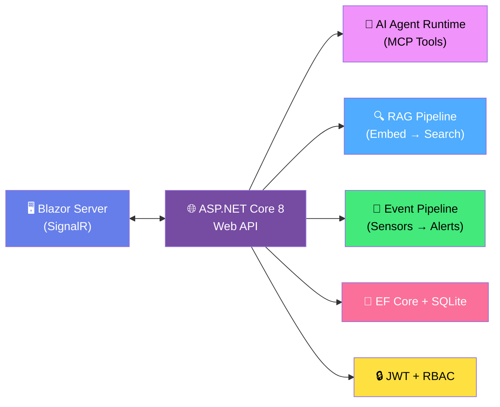

# 🏭 MicroForge — AI-Powered Manufacturing Intelligence Platform

> **A Micron-level C# Full Stack Engineering challenge — built from scratch with an AI coding assistant.**

---

## What is MicroForge?

MicroForge is a comprehensive AI-powered manufacturing intelligence platform built **entirely in C#** on .NET 8. It combines real-time production monitoring, anomaly detection, intelligent document search (RAG), and an extensible AI agent system into a single, containerized application.

This project is designed as a **challenging, portfolio-grade assignment** that tests skills equivalent to a **Micron AI Full Stack Engineer** role — but scoped to be achievable by a solo developer using a local AI coding assistant (Nemotron3-Super).

### Why MicroForge?

| Challenge | What It Tests |
|---|---|
| Build a full-stack C# application | ASP.NET Core, Blazor, EF Core mastery |
| Implement an AI agent with tool-use | MCP-style tool registry, JSON schemas, multi-step reasoning |
| Build a RAG pipeline from scratch | Document chunking, embeddings, vector search, grounded Q&A |
| Real-time sensor monitoring | SignalR, Channels, background services, anomaly detection |
| Enterprise security | JWT, RBAC, data boundaries, input validation |
| Production-grade engineering | Docker, observability, testing, clean architecture |

---

## 🎯 Project Purpose

This project serves as:

1. **A skills demonstration** — Prove you can build a production-grade AI platform in C#
2. **A learning exercise** — Practice advanced .NET patterns: Clean Architecture, CQRS, MCP tool-use, RAG
3. **A portfolio piece** — Show Micron (or any employer) what you can build
4. **A graded assignment** — Evaluate your work against a detailed 100-point rubric mapped to Micron's job requirements

---

## 📋 Prerequisites

Before you begin, ensure you have the following installed:

| Tool | Version | Check Command | Install |
|---|---|---|---|
| **.NET 8 SDK** | 8.0.100+ | `dotnet --version` | [Download](https://dotnet.microsoft.com/download/dotnet/8.0) |
| **Docker Desktop** | 24.x+ | `docker --version` | [Download](https://www.docker.com/products/docker-desktop/) |
| **Docker Compose** | 2.x+ | `docker compose version` | Included with Docker Desktop |
| **Git** | 2.x+ | `git --version` | [Download](https://git-scm.com/) |
| **Ollama** (optional) | 0.3.x+ | `ollama --version` | [Download](https://ollama.com/) |
| **VS Code or Visual Studio** | Latest | — | [VS Code](https://code.visualstudio.com/) / [VS 2022](https://visualstudio.microsoft.com/) |

### Optional: Local LLM Setup

To power the AI agent with a local LLM:

```bash
# Install Ollama and pull the model
ollama pull nemotron3-super

# Verify it's running
curl http://localhost:11434/api/tags
```

---

## 📁 Project Structure

```
MicroForge-CSharp-Project/
│
├── 📄 README.md                          ← You are here
│
├── 📐 architecture/
│   ├── system-design.md                  ← Comprehensive system design document
│   └── tech-stack.md                     ← Technology stack reference
│
├── 📊 grading/
│   ├── rubric.md                         ← Detailed 100-point grading rubric
│   └── evaluation-checklist.md           ← Checkbox evaluation form
│
├── 📋 scrum/                             ← Sprint planning & task breakdown (if applicable)
│
├── 📚 reference/                         ← C# tutorial and reference materials (if applicable)
│
└── src/                                  ← Source code (to be implemented)
    ├── MicroForge.Domain/                ← Entities, Value Objects, Interfaces
    ├── MicroForge.Application/           ← Services, DTOs, Validators
    ├── MicroForge.Infrastructure/        ← EF Core, AI, RAG, Auth, Events
    ├── MicroForge.Web/                   ← API Controllers, Blazor Pages, Hubs
    └── tests/
        ├── MicroForge.UnitTests/
        ├── MicroForge.IntegrationTests/
        └── MicroForge.AgentTests/
```

---

## 📖 Documentation Guide

### Architecture

| Document | Description |
|---|---|
| [system-design.md](./architecture/system-design.md) | Full system architecture with Mermaid diagrams, component details, data model, API design, security architecture, AI agent design, and deployment topology |
| [tech-stack.md](./architecture/tech-stack.md) | Complete technology stack with versions, NuGet packages, and rationale for every choice |

### Grading

| Document | Description |
|---|---|
| [rubric.md](./grading/rubric.md) | Detailed 100-point rubric across 10 categories with point breakdowns, "what to look for," and common pitfalls |
| [evaluation-checklist.md](./grading/evaluation-checklist.md) | Checkbox evaluation form for quick scoring during review |

---

## 🚀 Quick Start

### 1. Clone and Set Up

```bash
# Clone the repository
git clone <your-repo-url> MicroForge
cd MicroForge

# Restore packages
dotnet restore

# Apply database migrations
dotnet ef database update --project src/MicroForge.Infrastructure --startup-project src/MicroForge.Web
```

### 2. Configure Environment

```bash
# Set required secrets (development)
dotnet user-secrets set "Jwt:SecretKey" "your-32-char-minimum-secret-key-here!!" --project src/MicroForge.Web

# Or use environment variables
export Jwt__SecretKey="your-32-char-minimum-secret-key-here!!"
export AI__Endpoint="http://localhost:11434"
export AI__Model="nemotron3-super"
```

### 3. Run Locally

```bash
# Start the application
dotnet run --project src/MicroForge.Web

# Access the application
# Blazor UI:  https://localhost:5001
# Swagger:    https://localhost:5001/swagger
# Health:     https://localhost:5001/health
```

### 4. Run with Docker

```bash
# Build and start
docker compose up --build

# Access the application
# HTTP:       http://localhost:5000
# HTTPS:      https://localhost:5001
# Swagger:    http://localhost:5000/swagger
```

### 5. Run Tests

```bash
# Run all tests
dotnet test

# Run with coverage
dotnet test --collect:"XPlat Code Coverage"

# Run specific test project
dotnet test tests/MicroForge.UnitTests
```

---

## 🏗️ Architecture at a Glance



---

## 📊 Grading Overview

The project is graded on a **100-point scale** across 10 categories:

| # | Category | Points | Focus |
|---|---|---|---|
| 1 | Architecture & System Design | 15 | Clean Architecture, SOLID, design patterns |
| 2 | Full-Stack Implementation | 15 | API quality, Blazor UI, SignalR |
| 3 | Custom AI Agent System | 15 | MCP tools, multi-step reasoning, guardrails |
| 4 | RAG Implementation | 10 | Chunking, embeddings, semantic search |
| 5 | Data Persistence & Modeling | 10 | EF Core, schema design, caching |
| 6 | Security & Authentication | 10 | JWT, RBAC, data boundaries |
| 7 | Testing & Quality | 10 | Unit, integration, agent tests |
| 8 | Containerization & DevOps | 5 | Docker, docker-compose |
| 9 | Observability | 5 | Logging, health checks, metrics |
| 10 | Code Quality & Standards | 5 | Naming, documentation, Git |

| Grade | Range | Interpretation |
|---|---|---|
| **A+** | 95–100 | Exceeds Micron expectations |
| **A** | 90–94 | Meets Micron Senior level |
| **B+** | 85–89 | Meets Micron Mid level |
| **B** | 80–84 | Meets Micron Entry level |
| **C** | 70–79 | Needs improvement |
| **F** | <70 | Does not meet minimum bar |

See [rubric.md](./grading/rubric.md) for full details.

---

## 🛠️ Development Workflow

### Recommended Approach

1. **Read the architecture docs** — Understand the system before writing code
2. **Set up the solution structure** — Create the 4 projects (Domain, Application, Infrastructure, Web)
3. **Build the Domain layer** — Entities, interfaces, value objects
4. **Build the Data layer** — EF Core context, migrations, repositories
5. **Build the API** — Controllers, DTOs, validation
6. **Build the Blazor UI** — Pages, components, layouts
7. **Implement the AI Agent** — Tool registry, tools, runtime
8. **Implement RAG** — Chunker, embeddings, vector store, search
9. **Implement Event Pipeline** — Sensor simulator, anomaly detection, alerts
10. **Add Security** — JWT, RBAC, data boundaries
11. **Add Observability** — Serilog, health checks, metrics
12. **Write Tests** — Unit, integration, agent tests
13. **Containerize** — Dockerfile, docker-compose
14. **Polish** — Documentation, code quality, Git history

### Using Nemotron3-Super

This project is designed to be built with the help of a **local AI coding assistant**. Use it to:

- Generate boilerplate code and scaffolding
- Implement design patterns and interfaces
- Write unit tests
- Debug issues
- Explain C# concepts

> **Important:** The AI assists — you architect. Understanding *why* each component exists and how they interact is what this project tests.

---

## 📝 License

This project is an educational assignment. Use it for learning and portfolio purposes.

---

## 🤝 Acknowledgments

- Inspired by the **Micron AI Full Stack Engineer** job description
- Architecture patterns from Microsoft's [eShop reference application](https://github.com/dotnet/eShop)
- AI Agent patterns from the [Model Context Protocol (MCP)](https://modelcontextprotocol.io/)
- Built with ❤️ and **Nemotron3-Super**
