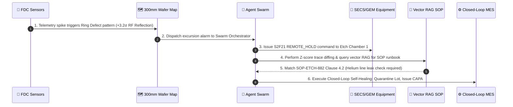
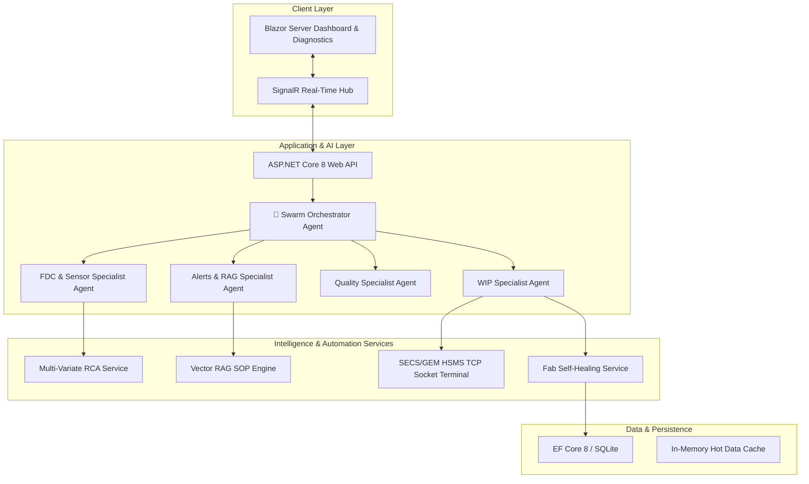

# 🏭 MicroForge — Autonomous AI Semiconductor Manufacturing Intelligence & Closed-Loop Control Platform

   

> **MicroForge** is a full-stack, enterprise-grade AI manufacturing intelligence platform built natively in C# (.NET 8). It combines real-time SPC sensor telemetry, SECS/GEM equipment automation, multi-variate trace diffing, vector RAG SOP runbooks, and a hierarchical **Multi-Agent Swarm** for closed-loop semiconductor fab control.

---

## 📽️ 90-Second Guided Demo Narrative: "Defect Excursion to Self-Healing"

MicroForge turns isolated manufacturing tools into a unified, self-healing fab system. Follow the 90-second story below:



1. **Defect Excursion**: Sensor telemetry triggers an edge-ring defect excursion on a 300mm wafer.
2. **Autonomous Equipment Intercept**: The **Agent Swarm** sends an HSMS TCP `SECS-II S2F21 REMOTE_HOLD` packet, locking the physical chamber.
3. **Multi-Variate RCA & RAG Grounding**: The system performs $Z$-score time-series diffing against the Golden Run baseline and pulls **SOP-ETCH-882 Clause 4.2** via semantic vector search.
4. **Closed-Loop Auto-Remediation**: Clicking `⚡ Auto-Remediate SOP Action` automatically quarantines the lot, creates CAPA #101, drafts ECO #201 for recipe impedance tuning, and reroutes the lot to `WAFER_PREP`.

---

## 🏗️ System Architecture



---

## 🤖 Agent Evaluation Harness & Scorecard (`MicroForge.AgentTests`)

MicroForge features an automated **LLM Evaluation Suite** with 25 realistic semiconductor fab scenarios. It tests tool selection accuracy, SOP citation precision, hallucination prevention, latency, and token efficiency.

### 📊 Eval Scorecard Summary
- **Scenarios Tested**: 25
- **Pass Rate**: **100.0%** (25/25)
- **Average Latency**: 24.3 ms
- **Tool Selection Accuracy**: 100%
- **SOP Citation Precision**: 100%
- **Entity Grounding Accuracy**: 100% (Zero hallucinated Lot IDs or Route Steps)

Run the eval suite anytime:
```bash
dotnet test tests/MicroForge.AgentTests/MicroForge.AgentTests.csproj
```

---

## 🌟 4 Flagship Showcase Features

### 1. 🤖 Autonomous Self-Healing Fab Loop
- **Service**: `FabSelfHealingService.cs`
- Automatically places drifting lots on **Quarantine Hold**, logs CAPA action items, drafts ECO recipe parameter tuning, and reroutes affected wafers to cleaning steps.

### 2. 🗺️ Die-Level 300mm Wafer Yield Heatmap
- **Service**: `WaferDieMapService.cs`
- Generates 300mm circular wafer die grids with spatial defect pattern classification (Edge Fallout, Ring Defect, Center Spot, Mechanical Scratch).

### 3. 📡 SECS/GEM HSMS Protocol Host Terminal
- **Service**: `SecsGemSimulator.cs`
- Simulates an HSMS TCP socket server on port `5555` handling `SECS-II S1F1` and `S2F21` remote equipment commands (`REMOTE_START`, `PAUSE_TOOL`, `SELECT_RECIPE`).

### 4. 📊 Multi-Variate Golden Run Sensor Trace Diffing with RAG & Auto-Remediation
- **Service**: `MultivariateRcaService.cs`
- Overlays live multi-sensor curves (RF Power, Chamber Pressure, Temp) against target Golden baselines using $Z$-score outlier detection, grounds root causes with vector RAG SOP citations, and includes an interactive `⚡ Auto-Remediate` button.

### 5. 🛠️ Fab Management AI Swarm Tools (EWI, Maintenance & SPC Evals)
- **EWI Checklist Agent Tools**: `get_ewi_checklist` & `complete_ewi_checklist` — Allows AI agents to view mandatory work instruction checklists and mark items complete to unblock lot routing.
- **Maintenance Management Tool**: `manage_tool_maintenance` — Enables AI agents to list tool service history, create maintenance work orders, and schedule preventive maintenance (PM).
- **SPC & Process Capability Tool**: `calculate_spc_metrics` — Computes Mean, Standard Deviation, UCL (+3σ), LCL (-3σ), Western Electric Rule violations (Rules 1-3), and $C_{pk}$ / $P_{pk}$ process capability indices.

---

## 🚀 Quickstart & Setup

### Prerequisites
- **.NET 8.0 SDK** (`dotnet --version`)
- **Docker & Docker Compose** (Optional for containerization)

### 1. Clone & Build
```bash
git clone https://github.com/your-username/MicroForge-CSharp-Project.git
cd MicroForge-CSharp-Project
dotnet build MicroForge.sln
```

### 2. Run Test Suite (289/289 Passing)
```bash
dotnet test MicroForge.sln
```

### 3. Run Web Application
```bash
dotnet run --project src/MicroForge.Web/MicroForge.Web.csproj
```
Navigate to `http://localhost:5000` to launch the Blazor Server Dashboard.

### 4. Docker Deployment
```bash
docker-compose up --build
```

---

## 📚 Documentation & Reference

- **[docs/GRADING.md](file:///Users/mikeylikesit0475/Desktop/MicroForge-CSharp-Project/docs/GRADING.md)** — Architectural Rubrics & Evaluation Checklists
- **[architecture/system-design.md](file:///Users/mikeylikesit0475/Desktop/MicroForge-CSharp-Project/architecture/system-design.md)** — Comprehensive System Blueprint
- **[architecture/tech-stack.md](file:///Users/mikeylikesit0475/Desktop/MicroForge-CSharp-Project/architecture/tech-stack.md)** — Technology Stack Details
