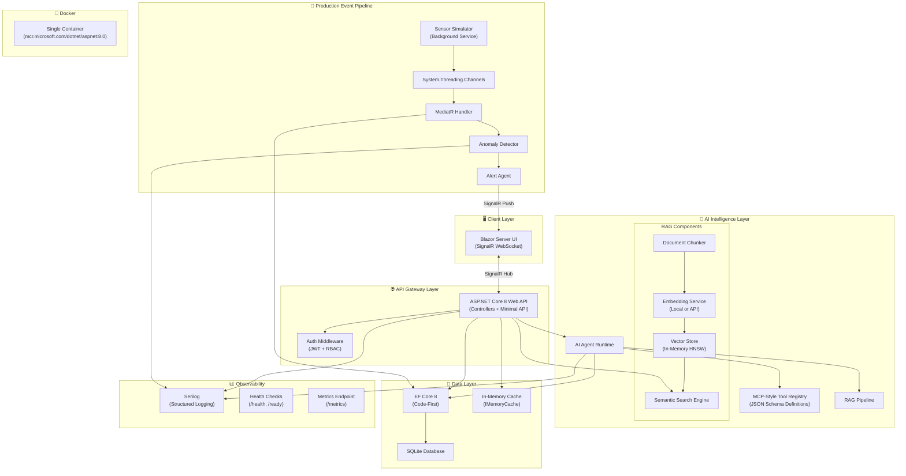
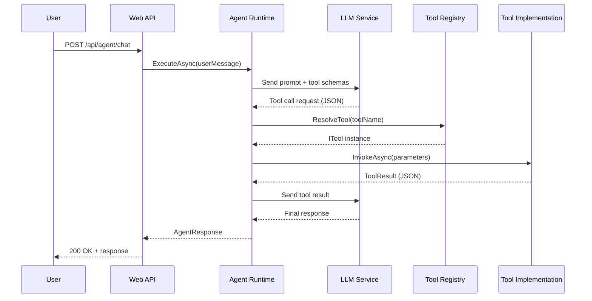
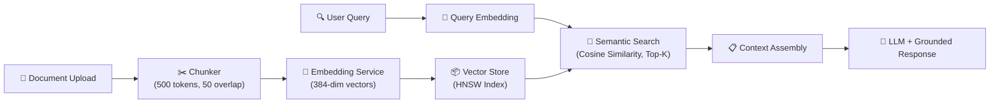
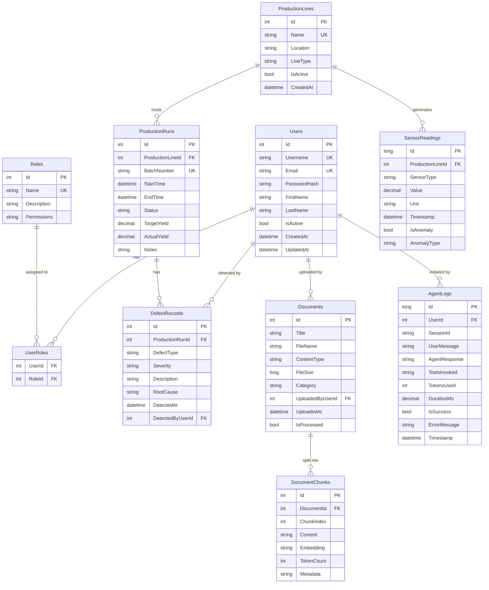
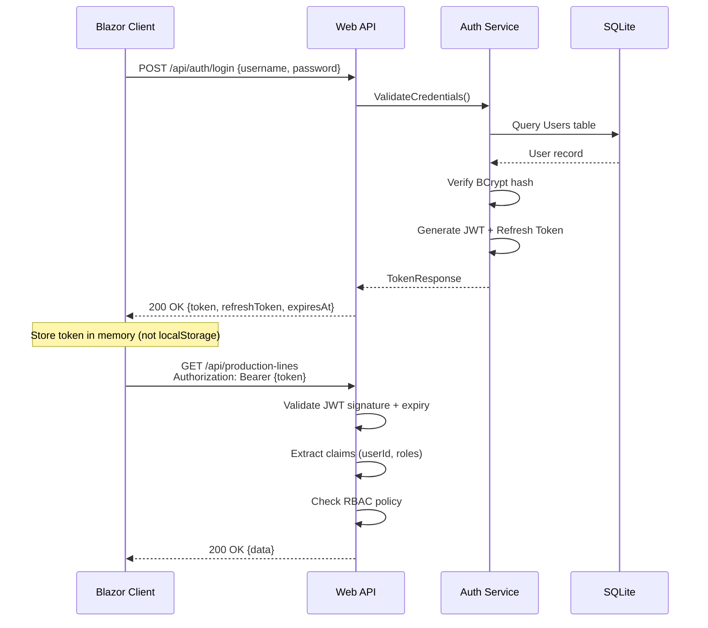
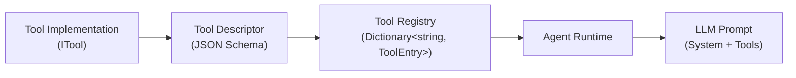
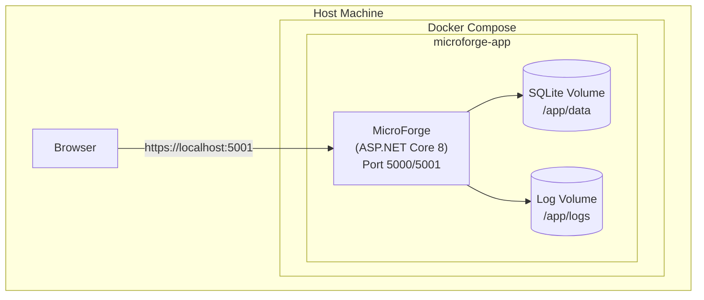

# MicroForge — System Design Document

> **Version:** 1.0  
> **Last Updated:** 2026-07-14  
> **Author:** Architecture Team  
> **Status:** Approved

---

## 1. System Overview

**MicroForge** is an AI-powered manufacturing intelligence platform designed to bring modern AI/ML capabilities to semiconductor and advanced manufacturing environments. It provides real-time production monitoring, anomaly detection, intelligent document search (RAG), and an extensible AI agent system — all built entirely in C# on the .NET 8 platform.

### 1.1 Mission

Empower manufacturing engineers and operators with AI-driven insights that reduce defect rates, optimize production throughput, and surface critical knowledge from unstructured documents — all through a single, unified platform.

### 1.2 Key Capabilities

| Capability | Description |
|---|---|
| **Real-Time Monitoring** | Ingest simulated sensor data from production lines, display live dashboards via SignalR |
| **Anomaly Detection** | Detect out-of-spec readings using statistical and ML-based rules, trigger alerts |
| **AI Agent System** | MCP-style tool registry allowing AI agents to invoke typed tools for multi-step reasoning |
| **RAG Pipeline** | Ingest manufacturing documents, chunk and embed them, enable semantic search and grounded Q&A |
| **Role-Based Access** | JWT authentication with RBAC ensuring data boundary enforcement per production line |
| **Observability** | Structured logging, health checks, and metrics for production-grade diagnostics |

### 1.3 Design Principles

1. **Clean Architecture** — Domain logic is decoupled from infrastructure concerns
2. **Contract-First** — All AI tools and API endpoints are defined by explicit interfaces/schemas
3. **Event-Driven** — Production events flow through channels and mediator patterns
4. **Security-by-Default** — Every endpoint is authenticated; authorization is role-based with data boundaries
5. **Observable** — Every significant operation emits structured logs and metrics
6. **Container-Ready** — The entire platform runs in a single Docker container for development simplicity

---

## 2. Architecture Diagram



---

## 3. Component Details

### 3.1 Blazor Server Frontend

| Aspect | Detail |
|---|---|
| **Responsibility** | Render the interactive UI including dashboards, agent chat, document search, and admin panels |
| **Technology** | Blazor Server (.NET 8) with SignalR transport |
| **Key Interfaces** | `IProductionDashboardHub`, `IAlertNotificationHub`, `IAgentChatHub` |
| **Rationale** | Blazor Server enables rich C# UI without JavaScript, leverages SignalR for real-time updates, and keeps the project 100% C#. Ideal for internal manufacturing tools where low-latency server connection is acceptable. |

**Key Pages:**

| Page | Route | Description |
|---|---|---|
| Dashboard | `/` | Real-time production line metrics, sensor gauges, alert feed |
| Agent Chat | `/agent` | Conversational AI interface with tool invocation visualization |
| Document Search | `/documents` | Upload documents, semantic search, RAG-grounded Q&A |
| Production Runs | `/production` | CRUD for production runs, defect records |
| Admin | `/admin` | User management, role assignment, system health |

### 3.2 ASP.NET Core 8 Web API

| Aspect | Detail |
|---|---|
| **Responsibility** | Expose RESTful endpoints for all platform operations; host SignalR hubs |
| **Technology** | ASP.NET Core 8 with Controllers (resource-oriented) and Minimal API (utility endpoints) |
| **Key Interfaces** | `IProductionService`, `IDocumentService`, `IAgentService`, `IAuthService` |
| **Rationale** | ASP.NET Core 8 is the industry standard for C# APIs. Controllers provide clean separation per resource domain. Minimal API is used for lightweight utility endpoints. |

**Middleware Pipeline:**

```
Request → Exception Handler → CORS → Authentication → Authorization → Rate Limiting → Endpoint
```

### 3.3 AI Agent Runtime

| Aspect | Detail |
|---|---|
| **Responsibility** | Orchestrate AI agent execution: receive user queries, plan tool invocations, execute tools, synthesize responses |
| **Technology** | Custom runtime with `System.Text.Json` schema validation, `HttpClient` for LLM calls |
| **Key Interfaces** | `IAgentRuntime`, `IToolRegistry`, `ITool`, `IAgentExecutionContext` |
| **Rationale** | A custom MCP-style runtime provides full control over tool registration, invocation, and error handling. Avoids heavy framework dependencies while following the Model Context Protocol pattern. |

**Agent Execution Flow:**



### 3.4 RAG Pipeline

| Aspect | Detail |
|---|---|
| **Responsibility** | Ingest documents, split into chunks, generate embeddings, store vectors, perform semantic search, ground LLM responses |
| **Technology** | Custom chunker (recursive text splitter), embedding via local model or API, in-memory HNSW vector index |
| **Key Interfaces** | `IDocumentChunker`, `IEmbeddingService`, `IVectorStore`, `ISemanticSearchService` |
| **Rationale** | Building the RAG pipeline from scratch demonstrates deep understanding of retrieval-augmented generation. In-memory HNSW avoids external vector DB dependencies while remaining performant for the project scope. |

**Pipeline Flow:**



**Chunking Strategy:**

| Parameter | Value | Rationale |
|---|---|---|
| Chunk Size | 500 tokens | Balances context richness with embedding quality |
| Overlap | 50 tokens | Prevents losing information at chunk boundaries |
| Separator Priority | `\n\n` > `\n` > `. ` > ` ` | Respects document structure hierarchy |

### 3.5 Production Event Pipeline

| Aspect | Detail |
|---|---|
| **Responsibility** | Simulate sensor data, detect anomalies, trigger alerts in real-time |
| **Technology** | `System.Threading.Channels` for buffered async streams, `MediatR` for event dispatch, `IHostedService` for background simulation |
| **Key Interfaces** | `ISensorSimulator`, `INotification` (MediatR), `IAnomalyDetector`, `IAlertService` |
| **Rationale** | Channels provide high-performance, bounded async producer-consumer queues. MediatR enables clean separation between event production and handling. This mirrors real-world IoT event pipelines at smaller scale. |

**Anomaly Detection Rules:**

| Rule | Threshold | Action |
|---|---|---|
| Temperature Spike | > 3σ from rolling mean | Critical Alert |
| Pressure Drop | < lower control limit | Warning Alert |
| Vibration Anomaly | Z-score > 2.5 | Investigation Alert |
| Yield Deviation | > 2σ from target | Production Alert |

### 3.6 Data Layer

| Aspect | Detail |
|---|---|
| **Responsibility** | Persist all application data with proper relational modeling, caching, and query optimization |
| **Technology** | EF Core 8 (Code-First) + SQLite + `IMemoryCache` |
| **Key Interfaces** | `IUnitOfWork`, `IRepository<T>`, `IQueryableExtensions` |
| **Rationale** | EF Core 8 is the standard ORM for .NET. SQLite requires zero infrastructure setup — ideal for a self-contained project. In-memory caching reduces database load for read-heavy operations. |

### 3.7 Auth Layer

| Aspect | Detail |
|---|---|
| **Responsibility** | Authenticate users via JWT, enforce RBAC policies, validate data access boundaries |
| **Technology** | ASP.NET Core Identity (simplified), JWT Bearer tokens, custom `IAuthorizationHandler` |
| **Key Interfaces** | `IAuthService`, `ITokenService`, `IDataBoundaryPolicy` |
| **Rationale** | JWT is the standard for stateless API authentication. Custom authorization handlers enable fine-grained data boundary enforcement (e.g., operators can only see their assigned production lines). |

### 3.8 Observability

| Aspect | Detail |
|---|---|
| **Responsibility** | Provide structured logging, health check endpoints, and runtime metrics |
| **Technology** | Serilog (structured logging to console + file), ASP.NET Core Health Checks, custom metrics middleware |
| **Key Interfaces** | `ILogger<T>` (via Serilog), `IHealthCheck`, `IMetricsCollector` |
| **Rationale** | Serilog is the de facto structured logging library for .NET. Health checks enable container orchestrators to manage lifecycle. Metrics provide visibility into runtime performance. |

---

## 4. Data Model



### 4.1 Table Descriptions

| Table | Purpose | Key Indexes |
|---|---|---|
| **Users** | Store user accounts and credentials | `IX_Users_Username`, `IX_Users_Email` |
| **Roles** | Define RBAC roles (Admin, Engineer, Operator, Viewer) | `IX_Roles_Name` |
| **UserRoles** | Many-to-many join table for user-role assignments | Composite PK `(UserId, RoleId)` |
| **ProductionLines** | Physical or logical production line definitions | `IX_ProductionLines_Name` |
| **ProductionRuns** | Individual batch runs on a production line | `IX_ProductionRuns_LineId_StartTime` |
| **DefectRecords** | Quality defects detected during production | `IX_DefectRecords_RunId`, `IX_DefectRecords_Severity` |
| **SensorReadings** | Time-series sensor data (temperature, pressure, vibration) | `IX_SensorReadings_LineId_Timestamp` |
| **Documents** | Uploaded manufacturing documents (SOPs, specs, reports) | `IX_Documents_Category` |
| **DocumentChunks** | Chunked and embedded document fragments for RAG | `IX_DocumentChunks_DocumentId` |
| **AgentLogs** | Audit trail of all AI agent interactions | `IX_AgentLogs_UserId_Timestamp` |

---

## 5. API Design

### 5.1 Authentication

| Method | Path | Description | Auth |
|---|---|---|---|
| `POST` | `/api/auth/register` | Register a new user | Public |
| `POST` | `/api/auth/login` | Authenticate and receive JWT | Public |
| `POST` | `/api/auth/refresh` | Refresh an expired token | Bearer |
| `GET` | `/api/auth/me` | Get current user profile | Bearer |

**Login Request:**
```json
{
  "username": "string",
  "password": "string"
}
```

**Login Response:**
```json
{
  "token": "string (JWT)",
  "refreshToken": "string",
  "expiresAt": "2026-07-14T20:00:00Z",
  "user": {
    "id": 1,
    "username": "string",
    "roles": ["Engineer"]
  }
}
```

### 5.2 Production Lines

| Method | Path | Description | Auth | Roles |
|---|---|---|---|---|
| `GET` | `/api/production-lines` | List all production lines | Bearer | All |
| `GET` | `/api/production-lines/{id}` | Get production line details | Bearer | All |
| `POST` | `/api/production-lines` | Create a production line | Bearer | Admin, Engineer |
| `PUT` | `/api/production-lines/{id}` | Update a production line | Bearer | Admin, Engineer |
| `DELETE` | `/api/production-lines/{id}` | Deactivate a production line | Bearer | Admin |
| `GET` | `/api/production-lines/{id}/sensors/live` | SSE stream of live sensor data | Bearer | All |

### 5.3 Production Runs

| Method | Path | Description | Auth | Roles |
|---|---|---|---|---|
| `GET` | `/api/production-runs` | List runs (filterable) | Bearer | All |
| `GET` | `/api/production-runs/{id}` | Get run details with defects | Bearer | All |
| `POST` | `/api/production-runs` | Create a new run | Bearer | Engineer, Operator |
| `PUT` | `/api/production-runs/{id}` | Update run status/yield | Bearer | Engineer, Operator |
| `GET` | `/api/production-runs/{id}/defects` | List defects for a run | Bearer | All |
| `POST` | `/api/production-runs/{id}/defects` | Report a defect | Bearer | Engineer, Operator |

### 5.4 Sensor Readings

| Method | Path | Description | Auth | Roles |
|---|---|---|---|---|
| `GET` | `/api/sensors/readings` | Query historical readings | Bearer | All |
| `GET` | `/api/sensors/anomalies` | List detected anomalies | Bearer | Engineer, Admin |
| `GET` | `/api/sensors/statistics/{lineId}` | Get statistical summaries | Bearer | All |

### 5.5 Documents & RAG

| Method | Path | Description | Auth | Roles |
|---|---|---|---|---|
| `POST` | `/api/documents/upload` | Upload a document | Bearer | Engineer, Admin |
| `GET` | `/api/documents` | List all documents | Bearer | All |
| `GET` | `/api/documents/{id}` | Get document metadata | Bearer | All |
| `DELETE` | `/api/documents/{id}` | Delete a document and its chunks | Bearer | Admin |
| `POST` | `/api/documents/search` | Semantic search across documents | Bearer | All |
| `POST` | `/api/documents/ask` | RAG-grounded Q&A | Bearer | All |

**Semantic Search Request:**
```json
{
  "query": "What is the recommended temperature range for photolithography?",
  "topK": 5,
  "category": "SOP"
}
```

**Semantic Search Response:**
```json
{
  "results": [
    {
      "documentId": 3,
      "documentTitle": "Photolithography SOP v2.1",
      "chunkContent": "The recommended temperature range for the photolithography process is...",
      "similarity": 0.89,
      "chunkIndex": 12
    }
  ],
  "queryEmbeddingTimeMs": 45,
  "searchTimeMs": 12
}
```

### 5.6 AI Agent

| Method | Path | Description | Auth | Roles |
|---|---|---|---|---|
| `POST` | `/api/agent/chat` | Send a message to the AI agent | Bearer | Engineer, Admin |
| `GET` | `/api/agent/tools` | List available tools and schemas | Bearer | Engineer, Admin |
| `GET` | `/api/agent/history` | Get agent interaction history | Bearer | Engineer, Admin |
| `GET` | `/api/agent/sessions/{sessionId}` | Get a specific session's log | Bearer | Engineer, Admin |

**Chat Request:**
```json
{
  "message": "What production line had the most defects last week?",
  "sessionId": "optional-session-id",
  "context": {
    "productionLineId": null
  }
}
```

**Chat Response:**
```json
{
  "response": "Based on the data, Production Line Alpha had 23 defects last week...",
  "toolsUsed": [
    {
      "name": "query_defects",
      "input": { "dateRange": "last_week", "groupBy": "production_line" },
      "output": { "results": [...] },
      "durationMs": 120
    }
  ],
  "sessionId": "abc-123",
  "tokensUsed": 1250
}
```

### 5.7 Admin

| Method | Path | Description | Auth | Roles |
|---|---|---|---|---|
| `GET` | `/api/admin/users` | List all users | Bearer | Admin |
| `PUT` | `/api/admin/users/{id}/roles` | Update user roles | Bearer | Admin |
| `GET` | `/api/admin/system/health` | Detailed health status | Bearer | Admin |
| `GET` | `/api/admin/system/metrics` | Runtime metrics | Bearer | Admin |

### 5.8 Health & Diagnostics (Unauthenticated)

| Method | Path | Description |
|---|---|---|
| `GET` | `/health` | Liveness probe |
| `GET` | `/ready` | Readiness probe (DB + services) |
| `GET` | `/metrics` | Prometheus-compatible metrics |

---

## 6. Security Architecture

### 6.1 JWT Authentication Flow



### 6.2 JWT Token Structure

```json
{
  "header": {
    "alg": "HS256",
    "typ": "JWT"
  },
  "payload": {
    "sub": "1",
    "username": "engineer01",
    "roles": ["Engineer"],
    "productionLineIds": [1, 2, 3],
    "iat": 1720990800,
    "exp": 1720994400,
    "iss": "MicroForge",
    "aud": "MicroForge.Client"
  }
}
```

### 6.3 RBAC Matrix

| Resource | Admin | Engineer | Operator | Viewer |
|---|---|---|---|---|
| Users (CRUD) | ✅ Full | ❌ | ❌ | ❌ |
| Roles (Assign) | ✅ Full | ❌ | ❌ | ❌ |
| Production Lines (CRUD) | ✅ Full | ✅ Create/Update | ❌ Read Only | ✅ Read |
| Production Runs | ✅ Full | ✅ Full | ✅ Create/Update | ✅ Read |
| Defect Records | ✅ Full | ✅ Full | ✅ Create | ✅ Read |
| Sensor Data | ✅ Full | ✅ Read | ✅ Read (own lines) | ✅ Read |
| Documents | ✅ Full | ✅ Upload/Read | ❌ Read Only | ✅ Read |
| AI Agent | ✅ Full | ✅ Chat | ❌ | ❌ |
| System Admin | ✅ Full | ❌ | ❌ | ❌ |

### 6.4 Data Boundary Enforcement

Operators and Viewers are restricted to data from their assigned production lines. This is enforced at the query level:

```csharp
// IDataBoundaryPolicy implementation
public IQueryable<T> ApplyBoundary<T>(IQueryable<T> query, ClaimsPrincipal user) 
    where T : IProductionLineBound
{
    if (user.IsInRole("Admin") || user.IsInRole("Engineer"))
        return query; // Full access
    
    var allowedLineIds = user.GetProductionLineIds();
    return query.Where(x => allowedLineIds.Contains(x.ProductionLineId));
}
```

### 6.5 Security Checklist

- ✅ Passwords hashed with BCrypt (work factor 12)
- ✅ JWT signed with HMAC-SHA256, 1-hour expiry
- ✅ Refresh tokens are single-use with rotation
- ✅ All endpoints require authentication (except `/health`, `/ready`, auth endpoints)
- ✅ Input validation on all models via `DataAnnotations` and `FluentValidation`
- ✅ SQL injection prevented via EF Core parameterized queries
- ✅ XSS prevented via Blazor's built-in encoding
- ✅ CORS restricted to known origins
- ✅ Rate limiting on auth endpoints (5 req/min)
- ✅ Sensitive data excluded from logs via Serilog destructuring policies

---

## 7. AI Agent Architecture

### 7.1 MCP-Style Tool Registry

The AI agent system follows the **Model Context Protocol (MCP)** pattern, where tools are registered as typed objects with JSON Schema definitions. The LLM receives tool schemas and can request tool invocations, which the runtime validates and executes.

**Tool Registration Flow:**



### 7.2 ITool Interface

```csharp
public interface ITool
{
    string Name { get; }
    string Description { get; }
    JsonElement Schema { get; }          // JSON Schema for input validation
    Task<ToolResult> InvokeAsync(
        JsonElement parameters, 
        IAgentExecutionContext context, 
        CancellationToken ct);
}

public record ToolResult(
    bool IsSuccess,
    JsonElement Data,
    string? ErrorMessage = null);

public interface IAgentExecutionContext
{
    ClaimsPrincipal User { get; }
    string SessionId { get; }
    IServiceProvider Services { get; }
    void Log(string message, LogLevel level = LogLevel.Information);
}
```

### 7.3 Tool Schema Example

```json
{
  "name": "query_production_defects",
  "description": "Query defect records for production runs. Can filter by production line, date range, severity, and defect type.",
  "parameters": {
    "type": "object",
    "properties": {
      "productionLineId": {
        "type": "integer",
        "description": "Filter by production line ID"
      },
      "startDate": {
        "type": "string",
        "format": "date",
        "description": "Start of date range (ISO 8601)"
      },
      "endDate": {
        "type": "string",
        "format": "date",
        "description": "End of date range (ISO 8601)"
      },
      "severity": {
        "type": "string",
        "enum": ["Critical", "Major", "Minor", "Cosmetic"],
        "description": "Filter by defect severity"
      },
      "limit": {
        "type": "integer",
        "default": 20,
        "maximum": 100,
        "description": "Maximum number of results"
      }
    },
    "required": []
  }
}
```

### 7.4 Available Tools

| Tool Name | Description | Category |
|---|---|---|
| `query_production_defects` | Query and filter defect records | Data |
| `query_sensor_readings` | Query historical sensor data with aggregations | Data |
| `get_production_line_status` | Get current status of a production line | Data |
| `get_production_run_summary` | Get yield and defect summary for a run | Data |
| `search_documents` | Semantic search across embedded documents | RAG |
| `calculate_statistics` | Compute statistical metrics on numeric data | Compute |
| `detect_anomalies` | Run anomaly detection on a sensor data window | AI |
| `create_alert` | Create a new alert for a production issue | Action |
| `get_yield_trend` | Get yield trend data for charting | Data |

### 7.5 Multi-Step Reasoning

The agent runtime supports multi-step tool invocations. The LLM can chain tool calls to answer complex queries:

```
User: "Compare defect rates between Line Alpha and Line Beta for Q2, 
       and check if any anomalies correlate with the defect spikes."

Agent Plan:
  1. query_production_defects(lineId=1, startDate="2026-04-01", endDate="2026-06-30")
  2. query_production_defects(lineId=2, startDate="2026-04-01", endDate="2026-06-30")  
  3. query_sensor_readings(lineId=1, anomaliesOnly=true, startDate="2026-04-01", endDate="2026-06-30")
  4. calculate_statistics(data=[...defect counts...], metrics=["mean", "std", "trend"])
  5. Synthesize final response with grounded data
```

### 7.6 Error Handling & Guardrails

| Guardrail | Implementation |
|---|---|
| **Input Validation** | JSON Schema validation before tool invocation |
| **Timeout** | 30-second per-tool timeout, 2-minute total session timeout |
| **Max Iterations** | Maximum 10 tool calls per session to prevent infinite loops |
| **Data Boundary** | Tools enforce the same RBAC + data boundaries as API endpoints |
| **Output Sanitization** | Tool results are sanitized before being sent back to the LLM |
| **Fallback** | If a tool fails, the agent acknowledges the failure gracefully |
| **Audit Logging** | Every tool invocation is logged to `AgentLogs` table |

---

## 8. Deployment Architecture

### 8.1 Docker Topology



### 8.2 Dockerfile

```dockerfile
# Build stage
FROM mcr.microsoft.com/dotnet/sdk:8.0 AS build
WORKDIR /src
COPY *.sln .
COPY src/ src/
COPY tests/ tests/
RUN dotnet restore
RUN dotnet publish src/MicroForge.Web/MicroForge.Web.csproj \
    -c Release -o /app/publish

# Runtime stage
FROM mcr.microsoft.com/dotnet/aspnet:8.0 AS runtime
WORKDIR /app
COPY --from=build /app/publish .

RUN mkdir -p /app/data /app/logs

EXPOSE 5000 5001

HEALTHCHECK --interval=30s --timeout=5s --retries=3 \
    CMD curl -f http://localhost:5000/health || exit 1

ENTRYPOINT ["dotnet", "MicroForge.Web.dll"]
```

### 8.3 Docker Compose

```yaml
version: "3.8"

services:
  microforge:
    build:
      context: .
      dockerfile: Dockerfile
    container_name: microforge-app
    ports:
      - "5000:5000"
      - "5001:5001"
    environment:
      - ASPNETCORE_ENVIRONMENT=Production
      - ASPNETCORE_URLS=http://+:5000;https://+:5001
      - ConnectionStrings__DefaultConnection=Data Source=/app/data/microforge.db
      - Jwt__SecretKey=${JWT_SECRET_KEY}
      - Jwt__Issuer=MicroForge
      - Jwt__Audience=MicroForge.Client
      - Logging__LogLevel__Default=Information
      - AI__Endpoint=${AI_ENDPOINT:-http://localhost:11434}
      - AI__Model=${AI_MODEL:-nemotron3-super}
    volumes:
      - microforge-data:/app/data
      - microforge-logs:/app/logs
    restart: unless-stopped
    healthcheck:
      test: ["CMD", "curl", "-f", "http://localhost:5000/health"]
      interval: 30s
      timeout: 5s
      retries: 3

volumes:
  microforge-data:
  microforge-logs:
```

### 8.4 Environment Configuration

| Variable | Description | Default |
|---|---|---|
| `ASPNETCORE_ENVIRONMENT` | Runtime environment | `Development` |
| `ConnectionStrings__DefaultConnection` | SQLite connection string | `Data Source=microforge.db` |
| `Jwt__SecretKey` | HMAC-SHA256 signing key (min 32 chars) | *Required* |
| `Jwt__Issuer` | Token issuer claim | `MicroForge` |
| `Jwt__Audience` | Token audience claim | `MicroForge.Client` |
| `Jwt__ExpiryMinutes` | Token expiration in minutes | `60` |
| `AI__Endpoint` | LLM API endpoint URL | `http://localhost:11434` |
| `AI__Model` | LLM model name | `nemotron3-super` |
| `RAG__ChunkSize` | Document chunk size in tokens | `500` |
| `RAG__ChunkOverlap` | Chunk overlap in tokens | `50` |
| `RAG__TopK` | Number of search results to return | `5` |

---

## 9. Project Structure

```
MicroForge/
├── src/
│   ├── MicroForge.Domain/              # Entities, Value Objects, Domain Events
│   │   ├── Entities/
│   │   ├── ValueObjects/
│   │   ├── Events/
│   │   └── Interfaces/
│   ├── MicroForge.Application/         # Use Cases, DTOs, Validators
│   │   ├── Services/
│   │   ├── DTOs/
│   │   ├── Validators/
│   │   └── Interfaces/
│   ├── MicroForge.Infrastructure/      # EF Core, External Services, AI
│   │   ├── Data/
│   │   │   ├── MicroForgeDbContext.cs
│   │   │   ├── Migrations/
│   │   │   └── Repositories/
│   │   ├── AI/
│   │   │   ├── AgentRuntime.cs
│   │   │   ├── ToolRegistry.cs
│   │   │   └── Tools/
│   │   ├── RAG/
│   │   │   ├── DocumentChunker.cs
│   │   │   ├── EmbeddingService.cs
│   │   │   ├── VectorStore.cs
│   │   │   └── SemanticSearchService.cs
│   │   ├── Events/
│   │   │   ├── SensorSimulator.cs
│   │   │   └── AnomalyDetector.cs
│   │   ├── Auth/
│   │   │   ├── TokenService.cs
│   │   │   └── DataBoundaryPolicy.cs
│   │   └── Logging/
│   │       └── SerilogConfiguration.cs
│   └── MicroForge.Web/                 # API Controllers, Blazor Pages, Hubs
│       ├── Controllers/
│       ├── Hubs/
│       ├── Pages/
│       ├── Components/
│       ├── wwwroot/
│       └── Program.cs
├── tests/
│   ├── MicroForge.UnitTests/
│   ├── MicroForge.IntegrationTests/
│   └── MicroForge.AgentTests/
├── architecture/
│   ├── system-design.md
│   └── tech-stack.md
├── grading/
│   ├── rubric.md
│   └── evaluation-checklist.md
├── docker-compose.yml
├── Dockerfile
├── MicroForge.sln
└── README.md
```

---

## 10. Non-Functional Requirements

| Requirement | Target | Rationale |
|---|---|---|
| **Response Time** | API < 200ms (p95) | Manufacturing dashboards need snappy updates |
| **Throughput** | 100 sensor readings/sec | Simulated scale for single-container deployment |
| **Availability** | Health check passes within 5s | Docker health check compliance |
| **Data Retention** | Sensor data: 30 days | SQLite storage management |
| **Concurrency** | 10 simultaneous users | Blazor Server capacity for team use |
| **Security** | OWASP Top 10 aware | Enterprise security baseline |
| **Test Coverage** | > 70% line coverage | Quality gate for submission |
