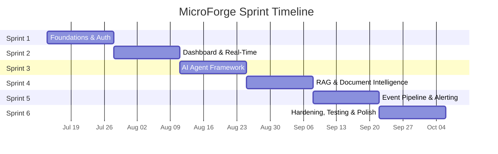

# MicroForge — Sprint Plan

> **Project:** MicroForge — AI-Powered Manufacturing Intelligence Platform
> **Sprint Duration:** 2 weeks each (6 sprints total = 12 weeks)
> **Estimated Velocity:** 25–35 story points per sprint (solo developer + AI assistant)
> **Last Updated:** 2026-07-14

---

## Sprint Overview



---

## Sprint 1 — "Laying the Foundation"

> **Dates:** July 14 – July 27, 2026

### Sprint Goal

> Establish the project structure, database schema, authentication/authorization system, Docker configuration, and caching layer so that the platform has a fully functional, secure, containerized foundation ready for feature development.

### Committed Stories

| Story ID | Story Title | Points | Priority |
|---|---|---|---|
| MF-001 | Solution Scaffolding & Project Structure | 3 | Must Have |
| MF-002 | SQLite Database Schema & EF Core Setup | 5 | Must Have |
| MF-003 | JWT Authentication Service | 5 | Must Have |
| MF-004 | Role-Based Authorization & Data Boundaries | 5 | Must Have |
| MF-005 | Docker & docker-compose Configuration | 3 | Must Have |
| MF-006 | In-Memory Cache Service | 3 | Should Have |
| MF-029 | Serilog Structured Logging | 3 | Must Have |
| MF-039 | API Documentation & OpenAPI Spec | 3 | Must Have |

### Sprint Metrics

| Metric | Value |
|---|---|
| **Total Story Points** | 30 |
| **Must Have Points** | 27 |
| **Should Have Points** | 3 |
| **Story Count** | 8 |

### Sprint Risks

| Risk | Likelihood | Impact | Mitigation |
|---|---|---|---|
| EF Core migration issues with SQLite type limitations | Medium | Medium | Use SQLite-compatible column types; avoid advanced SQL Server features early. |
| JWT configuration complexity (key management, claims) | Low | Medium | Use well-documented `Microsoft.AspNetCore.Authentication.JwtBearer`; follow official docs. |
| Docker multi-stage build issues with .NET 8 | Low | Low | Use official `mcr.microsoft.com/dotnet/` base images; test incrementally. |

### Definition of Done (Sprint-Specific)

- [ ] `dotnet build` compiles with zero errors across all projects.
- [ ] `docker-compose up --build` starts all services and API responds at `localhost:5000`.
- [ ] Login endpoint returns JWT; protected endpoints enforce authentication.
- [ ] Role-based authorization denies cross-role access.
- [ ] Data boundary filtering is verified with at least 2 seeded users.
- [ ] Serilog writes structured JSON logs to console and file.
- [ ] Swagger UI loads at `/swagger` with all Sprint 1 endpoints documented.
- [ ] All code reviewed via AI assistant with no high-severity issues.

### Key Deliverables

1. ✅ Buildable .NET 8 solution with clean architecture
2. ✅ SQLite database with seeded demo data
3. ✅ Working JWT auth flow (login → token → protected access)
4. ✅ Role-based access with data boundary enforcement
5. ✅ Docker containerization (docker-compose up works)
6. ✅ In-memory cache service with TTL
7. ✅ Structured logging (Serilog)
8. ✅ Swagger/OpenAPI documentation

---

## Sprint 2 — "Eyes on the Floor"

> **Dates:** July 28 – August 10, 2026

### Sprint Goal

> Build the Blazor Server manufacturing dashboard with real-time SignalR updates, production line status cards, yield/defect charts, and shift report summaries so that operators and engineers have a live window into production data.

### Committed Stories

| Story ID | Story Title | Points | Priority |
|---|---|---|---|
| MF-007 | Blazor Server Shell & Navigation | 3 | Must Have |
| MF-008 | Production Line Status Cards | 5 | Must Have |
| MF-009 | Real-Time SignalR Hub for Dashboard Updates | 5 | Must Have |
| MF-010 | Yield & Defect Charts | 5 | Should Have |
| MF-011 | Shift Report Summary View | 3 | Should Have |
| MF-030 | Health Check Endpoints | 3 | Must Have |
| MF-031 | Global Exception Handling Middleware | 3 | Must Have |

### Sprint Metrics

| Metric | Value |
|---|---|
| **Total Story Points** | 27 |
| **Must Have Points** | 19 |
| **Should Have Points** | 8 |
| **Story Count** | 7 |

### Sprint Risks

| Risk | Likelihood | Impact | Mitigation |
|---|---|---|---|
| SignalR connection stability in Blazor Server | Medium | High | Implement reconnection logic with exponential backoff from the start (MF-009 AC-3). |
| Chart library selection (Blazor-compatible) | Medium | Medium | Pre-evaluate options: Radzen, MudBlazor Charts, or lightweight JS interop with Chart.js. |
| Blazor Server state management complexity | Low | Medium | Use scoped services and cascading parameters; avoid over-engineering state. |

### Definition of Done (Sprint-Specific)

- [ ] Blazor app loads with functional navigation (sidebar, mobile responsive).
- [ ] Dashboard shows production line status cards that update via SignalR.
- [ ] Yield trend and defect distribution charts render with real data.
- [ ] Shift report summary displays current and previous shift metrics.
- [ ] Health check endpoints respond correctly for healthy and degraded states.
- [ ] Global exception handler returns RFC 7807 Problem Details for all errors.
- [ ] Data boundary enforcement applies to all dashboard data.
- [ ] No unhandled exceptions in browser console during normal usage.

### Key Deliverables

1. ✅ Blazor Server shell with role-aware navigation
2. ✅ Live production line status cards (SignalR-powered)
3. ✅ Interactive yield & defect charts
4. ✅ Shift report summary view
5. ✅ Health check endpoints (`/health/live`, `/health/ready`)
6. ✅ RFC 7807 global exception handling

---

## Sprint 3 — "Teaching the Machine"

> **Dates:** August 11 – August 24, 2026

### Sprint Goal

> Build the AI agent framework with a pluggable tool registry and implement all four core tools (QueryDefectHistory, PredictYield, SummarizeShiftReport, RecommendMaintenance), then expose the agent via a chat API and Blazor chat UI, so that users can interact with an AI agent grounded in manufacturing data.

### Committed Stories

| Story ID | Story Title | Points | Priority |
|---|---|---|---|
| MF-012 | Agent Runtime & Tool Registry | 8 | Must Have |
| MF-013 | QueryDefectHistory Tool | 3 | Must Have |
| MF-014 | PredictYield Tool | 5 | Must Have |
| MF-015 | SummarizeShiftReport Tool | 3 | Must Have |
| MF-016 | RecommendMaintenance Tool | 5 | Should Have |
| MF-017 | Agent Chat API Endpoint | 8 | Must Have |

### Sprint Metrics

| Metric | Value |
|---|---|
| **Total Story Points** | 32 |
| **Must Have Points** | 27 |
| **Should Have Points** | 5 |
| **Story Count** | 6 |

### Sprint Risks

| Risk | Likelihood | Impact | Mitigation |
|---|---|---|---|
| LLM integration complexity (prompt engineering, response parsing) | High | High | Start with a structured prompt template + deterministic tool dispatch; defer advanced LLM chaining to later. |
| Tool schema validation performance | Low | Low | Use `System.Text.Json` source generators for schema validation. |
| Agent chat latency (tool invocation chain) | Medium | Medium | Implement async tool execution; set 10-second timeout per tool invocation. |
| Scope creep on agent capabilities | Medium | High | Strictly limit to the 4 defined tools; defer new tools to future sprints. |

### Definition of Done (Sprint-Specific)

- [ ] Tool registry discovers and lists all 4 tools with their JSON schemas.
- [ ] Each tool executes correctly with valid input and returns schema-compliant output.
- [ ] Invalid tool input returns structured validation errors.
- [ ] Agent chat endpoint accepts natural language and returns tool-grounded responses.
- [ ] Agent chat enforces authentication and data boundaries.
- [ ] Agent response format includes `answer`, `toolsInvoked`, and `sources`.
- [ ] All tool invocations are logged via Serilog with correlation ID.

### Key Deliverables

1. ✅ Pluggable agent framework with IToolRegistry
2. ✅ 4 functional agent tools with JSON schemas
3. ✅ Agent chat API endpoint (`POST /api/v1/agent/chat`)
4. ✅ Tool invocation chain with validation and error handling

---

## Sprint 4 — "Knowledge at Your Fingertips"

> **Dates:** August 25 – September 7, 2026

### Sprint Goal

> Implement the RAG document intelligence pipeline (PDF upload → text extraction → chunking → embedding → vector store → semantic search) and the agent chat UI, so that the AI agent can ground its responses in uploaded manufacturing documents and users have a conversational interface.

### Committed Stories

| Story ID | Story Title | Points | Priority |
|---|---|---|---|
| MF-019 | Document Upload API | 3 | Must Have |
| MF-020 | PDF Text Extraction & Chunking | 5 | Must Have |
| MF-021 | Embedding Generation & Vector Store | 8 | Must Have |
| MF-022 | Semantic Search API | 5 | Must Have |
| MF-023 | Document Management UI | 5 | Should Have |
| MF-018 | Agent Chat UI Component | 5 | Should Have |

### Sprint Metrics

| Metric | Value |
|---|---|
| **Total Story Points** | 31 |
| **Must Have Points** | 21 |
| **Should Have Points** | 10 |
| **Story Count** | 6 |

### Sprint Risks

| Risk | Likelihood | Impact | Mitigation |
|---|---|---|---|
| Embedding model selection (local vs. API) | High | High | Use a lightweight model (e.g., ONNX-exported MiniLM) for local inference; avoid external API dependency. |
| PDF parsing quality (scanned PDFs, tables) | Medium | Medium | Support text-based PDFs only (v1); document this limitation. Flag scanned PDFs as "extraction_partial". |
| Vector store persistence complexity | Medium | Medium | Start with in-memory HNSW; add SQLite persistence as a follow-up within the sprint if time allows. |
| Large file upload handling | Low | Medium | Enforce 10 MB limit; use streaming multipart upload. |

### Definition of Done (Sprint-Specific)

- [ ] PDF upload accepts valid files, rejects non-PDF and oversized files.
- [ ] Text extraction produces readable plain text from multi-page PDFs.
- [ ] Chunking produces overlapping 500-token chunks with metadata.
- [ ] Embeddings are generated and stored in a searchable vector index.
- [ ] Semantic search returns top-K results ranked by similarity.
- [ ] Document management UI allows upload, status viewing, and deletion.
- [ ] Agent chat UI sends messages and displays tool-grounded responses.
- [ ] Semantic search integrates with agent framework as a grounding source.

### Key Deliverables

1. ✅ Document upload API with validation
2. ✅ PDF text extraction and chunking pipeline
3. ✅ Embedding generation and vector store
4. ✅ Semantic search API endpoint
5. ✅ Document management Blazor page
6. ✅ Agent chat UI component (slide-out panel)

---

## Sprint 5 — "The Pulse of Production"

> **Dates:** September 8 – September 21, 2026

### Sprint Goal

> Build the production event pipeline with simulated sensor data, anomaly detection, real-time alerting via SignalR, and an event history UI, so that the system detects and surfaces production anomalies in near-real-time.

### Committed Stories

| Story ID | Story Title | Points | Priority |
|---|---|---|---|
| MF-024 | Simulated Sensor Data Generator | 3 | Must Have |
| MF-025 | Event Ingestion Pipeline (Channels) | 5 | Must Have |
| MF-026 | Anomaly Detection Service | 5 | Must Have |
| MF-027 | Alert Notification Service | 5 | Must Have |
| MF-028 | Events History API & UI | 5 | Should Have |
| MF-032 | API Rate Limiting | 3 | Should Have |
| MF-033 | Security Headers & CORS Configuration | 2 | Should Have |

### Sprint Metrics

| Metric | Value |
|---|---|
| **Total Story Points** | 28 |
| **Must Have Points** | 18 |
| **Should Have Points** | 10 |
| **Story Count** | 7 |

### Sprint Risks

| Risk | Likelihood | Impact | Mitigation |
|---|---|---|---|
| Channel backpressure under simulated load | Medium | Medium | Use bounded channels with capacity 1000; monitor and log dropped events. |
| Anomaly detection false positives | Medium | Low | Use conservative thresholds initially; make thresholds configurable via `appsettings.json`. |
| SignalR broadcast storms from rapid events | Medium | High | Throttle SignalR broadcasts to max 1 per second per line; batch events if needed. |
| Consumer exception handling in pipeline | Low | High | Wrap each consumer in try/catch; log and continue on non-fatal errors. |

### Definition of Done (Sprint-Specific)

- [ ] Sensor simulator generates events at configurable intervals with realistic data.
- [ ] Channel pipeline processes events asynchronously without data loss.
- [ ] Anomaly detector flags events exceeding configurable thresholds.
- [ ] Alerts are broadcast via SignalR and persisted to the database.
- [ ] Dashboard shows toast notifications for critical alerts.
- [ ] Events history page displays filterable, paginated event data.
- [ ] Alert acknowledgment works via PATCH endpoint.
- [ ] Rate limiting is active on auth and general API endpoints.
- [ ] Security headers are present on all responses.

### Key Deliverables

1. ✅ Simulated sensor data generation (background service)
2. ✅ Channel-based event ingestion pipeline
3. ✅ Anomaly detection with configurable thresholds
4. ✅ Real-time alert notifications (SignalR + toast)
5. ✅ Events history API and Blazor UI page
6. ✅ API rate limiting
7. ✅ Security headers and CORS

---

## Sprint 6 — "Ship It"

> **Dates:** September 22 – October 5, 2026

### Sprint Goal

> Complete the test suite (unit, integration, agent tool harness), establish performance baselines, finalize observability, address accumulated technical debt, and prepare the system for demonstration, so that MicroForge is a polished, well-tested, deployable product.

### Committed Stories

| Story ID | Story Title | Points | Priority |
|---|---|---|---|
| MF-035 | Unit Test Foundation & Coverage Target | 5 | Must Have |
| MF-036 | Integration Tests for API Endpoints | 8 | Must Have |
| MF-037 | Agent Tool Test Harness | 5 | Must Have |
| MF-038 | Load & Performance Baseline | 3 | Could Have |
| MF-034 | Metrics Endpoint | 3 | Could Have |
| MF-040 | CI Pipeline Definition (GitHub Actions) | 3 | Could Have |

### Sprint Metrics

| Metric | Value |
|---|---|
| **Total Story Points** | 27 |
| **Must Have Points** | 18 |
| **Could Have Points** | 9 |
| **Story Count** | 6 |

### Sprint Risks

| Risk | Likelihood | Impact | Mitigation |
|---|---|---|---|
| Test coverage target (70%) difficult to reach in one sprint | Medium | Medium | Focus unit tests on Domain project first (highest value); expand to Infrastructure next. |
| Integration test flakiness with SQLite | Medium | Medium | Use separate temp DB per test class; ensure proper cleanup in test fixtures. |
| Technical debt items consuming sprint capacity | Medium | Medium | Time-box tech debt work to 20% of sprint capacity; prioritize items that affect demo quality. |
| CI pipeline Docker build time | Low | Low | Use Docker layer caching; consider building without Docker in CI if time is constrained. |

### Definition of Done (Sprint-Specific)

- [ ] ≥ 30 unit tests pass with ≥ 70% domain coverage.
- [ ] ≥ 10 integration tests pass covering key API flows.
- [ ] Agent tool test harness tests all 4 tools (≥ 3 cases each).
- [ ] Performance baselines documented for key endpoints.
- [ ] Metrics endpoint exposes system metrics.
- [ ] CI pipeline builds, tests, and creates Docker image.
- [ ] All critical and high technical debt items are resolved.
- [ ] System is demo-ready: clean UI, no console errors, stable SignalR, responsive agent.

### Key Deliverables

1. ✅ Comprehensive unit test suite (≥ 30 tests)
2. ✅ Integration test suite (≥ 10 tests)
3. ✅ Agent tool test harness
4. ✅ Performance baseline report
5. ✅ Metrics endpoint
6. ✅ GitHub Actions CI pipeline
7. ✅ Demo-ready system

---

## Sprint Velocity Projection

| Sprint | Planned Points | Estimated Velocity Range | Confidence |
|---|---|---|---|
| Sprint 1 | 30 | 28–32 | High (foundational, well-understood) |
| Sprint 2 | 27 | 25–30 | High (UI work, familiar patterns) |
| Sprint 3 | 32 | 26–34 | Medium (AI/LLM integration is new) |
| Sprint 4 | 31 | 25–33 | Medium (embedding/vector store learning curve) |
| Sprint 5 | 28 | 26–30 | High (event pipeline is well-defined) |
| Sprint 6 | 27 | 24–28 | Medium (testing + tech debt is variable) |
| **Total** | **175** | **154–187** | — |

> [!TIP]
> If Sprint 3 or Sprint 4 velocity drops below the lower bound, move the `Could Have` items from Sprint 6 into a potential Sprint 7 buffer. The solo developer should prioritize `Must Have` items in every sprint.

---

## Cumulative Burndown Target

```
Sprint | Remaining Points
-------|------------------
  0    | 175
  1    | 145
  2    | 118
  3    |  86
  4    |  55
  5    |  27
  6    |   0
```

> [!NOTE]
> Track actual velocity after each sprint and update this projection. If the project falls behind by > 15 points after Sprint 3, consider descoping `Could Have` items (MF-034, MF-038, MF-040) totaling 9 points.
